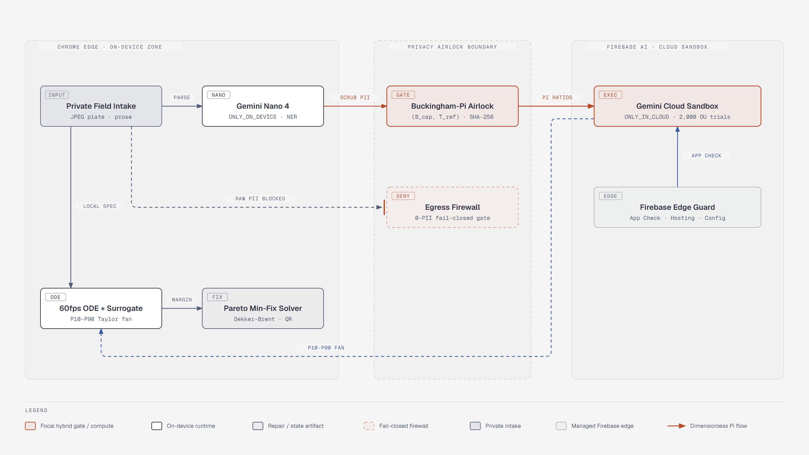
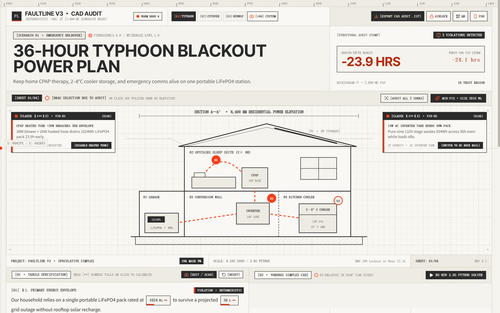
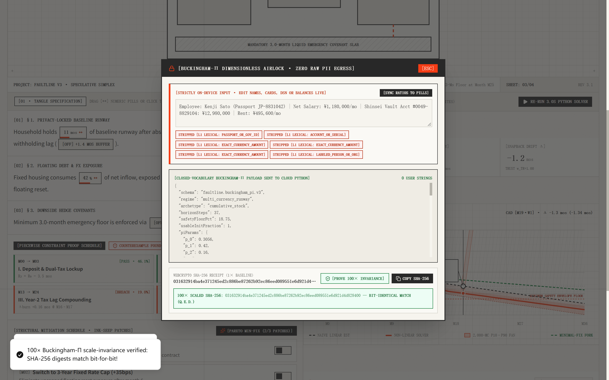
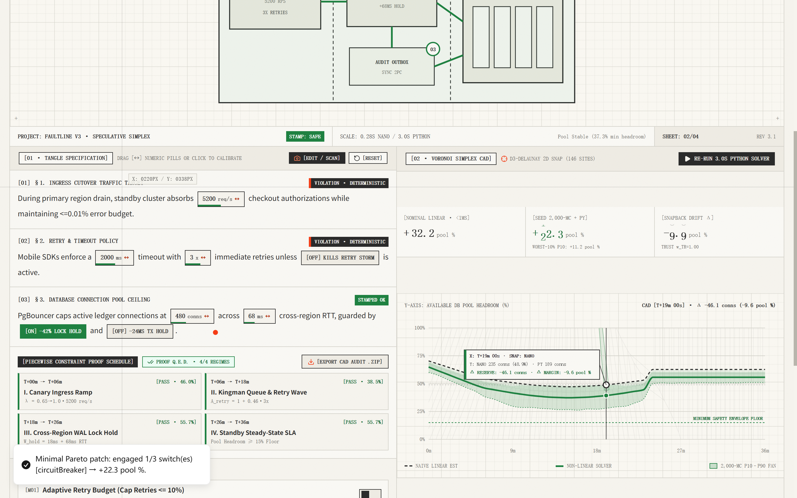
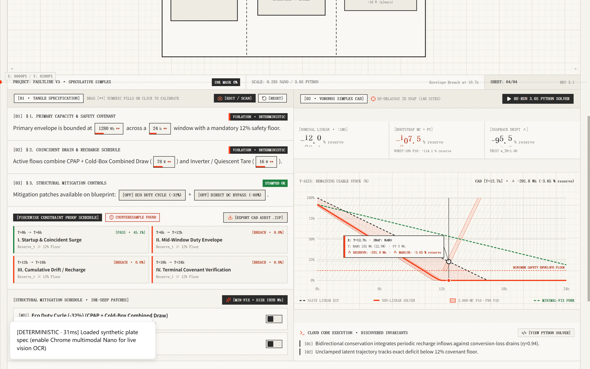

# FaultLine v3 · Hybrid AI Operational Stress-Test & CAD Audit Workbench

[](LICENSE)
[](https://firebase.google.com/docs/ai-logic)
[](https://developer.chrome.com/docs/ai/built-in)
[](#chrome-mv3-side-panel-extension)

**FaultLine v3** is a privacy-locked operational stress-testing workbench built on the **Firebase AI Logic Hybrid SDK (`firebase@13.4.0` / `@firebase/ai@3.1.0`)** and **Chrome Built-in AI (Gemini Nano 4)** for `#BuildHybridAI 2026`.

It bridges unstructured human emergency plans and hardware rating-plate photos with verified stochastic conservation and queueing physics—without ever transmitting raw PII, credentials, or currency balances off-device.



---

## Live Workbench Highlights

| Typhoon CPAP Holdover & 2,000-MC Fan | Buckingham-Π `100×` `SHA-256` Proof (`Q.E.D.`) |
| :---: | :---: |
|  |  |
| **Pareto Minimal-Fix Prescription (`CODE COMPLIANT`)** | **On-Device Multimodal Plate Scan (`SECTION D—D′`)** |
|  |  |

---

## Key Architectural Innovations

1. **Split-Brain `LLM-Modulo` Hybrid Runtime (`src/core/faultlineEngine.ts`)**
   - **On-Device (`ONLY_ON_DEVICE` / `PREFER_ON_DEVICE` · Gemini Nano 4)**: Extracts wattage (`W = V × A`), breaker ratings, and hidden quiescent tare from hardware nameplate photos via `<canvas>` JPEG `InlineDataPart`, compiles free-form operational plans into reactive Tangle clauses (`<120-token` compact JSON schema), and audits cross-clause contradictions with `AbortController` timeout protection.
   - **In-Cloud (`ONLY_IN_CLOUD` · Gemini Python `codeExecution`)**: Executes vectorized `(2000, 2d+1)` `numpy` Ornstein-Uhlenbeck correlated Monte Carlo simulations strictly on dimensionless ratios, with automatic `404/429/500/503` model fallback and reverse-scanned `__FL_MC_JSON_START__` sandbox extraction.

2. **Closed-Vocabulary Dual-Basis Buckingham-Π Privacy Airlock (`src/core/buckinghamAirlock.ts`)**
   - Combines L1 lexical/DSN regex + Luhn Mod-10 payment card verification, L2 Shannon entropy scanning, and L3 on-device NER.
   - Normalizes dimensional capacities and flow rates by local private bases `(B_cap, T_ref)` via 12-significant-digit IEEE-754 mantissa denoising (`canonicalizePiRatio`), guaranteeing **bit-identical outbound JSON and WebCrypto `SHA-256` receipts under arbitrary `λ` scaling (e.g. `100×` wealth or power scaling)** while transmitting **zero user-supplied substrings**.
   - Enforces a fail-closed `assertZeroSensitiveEgress()` firewall prior to every cloud request.

3. **Log-Spread Order-Preserving Multi-Fidelity Surrogate (`src/core/monteCarloSurrogate.ts`)**
   - Anchors zero-order median discrepancy in unclamped latent space, damps first-order slopes via adaptive Gaussian trust-region kernels `w_TR(θ)`, and evolves lower/upper half-spreads in log-exponential space with `+0.35 * S_0 * (1 - w_TR)` out-of-domain epistemic widening.
   - Mathematically guarantees **zero quantile crossing (`P10 < P50 < P90` everywhere)** and **60fps zero-quota offline scrubbing**.

4. **Unconditionally A-Stable Exponential Queue Integrator & Pareto Minimal-Fix Solver (`src/core/minimalRepairSolver.ts`)**
   - Eliminates explicit-Euler CFL stiffness oscillations on millisecond lock-hold queueing (`exp(-Δt / T_out)` with M/G/c P99 congestion tail & timeout reneging).
   - Runs exact `2^m` friction-weighted discrete search first, followed by derivative-free **16-step bounded Dekker-Brent continuous root-finding** on unclamped latent margins when discrete switches alone cannot satisfy safety covenants.

5. **Offline-First `?pocket=` Survival QR & Chrome MV3 Side-Panel Extension (`src/core/pocketCodec.ts`)**
   - Compresses scenario parameters and mitigations via `fflate.zlibSync` into `<300`-character `https://<host>/?pocket=<base64url>` links backed by `/sw.js` offline caching.
   - Ships an isomorphic Chrome Manifest V3 Side-Panel extension (`npm run build:ext` -> `dist-extension/`) with right-click `"Stress-Test Selection in FaultLine v3"`.

---

## Quick Start & Verification

```bash
# Install dependencies
npm install

# Run all 13 deterministic parity, 5,000-sample surrogate, Brent repair, Buckingham-Pi, and QR tests
npm test

# Typecheck & build production web bundle (dist/) + Chrome MV3 Side-Panel extension (dist-extension/)
npm run build
npm run build:ext
```

### Chrome MV3 Side-Panel Extension

1. Download `faultline-v3-chrome-mv3-extension.zip` from [GitHub Releases](../../releases) (or build locally via `npm run build:ext` -> `dist-extension/`).
2. Open `chrome://extensions`, enable **Developer mode**, and click **Load unpacked** selecting `dist-extension/`.
3. Highlight any operational runbook or contract text on any webpage, right-click **"Stress-Test Selection in FaultLine v3"**, and audit margins directly in the Chrome Side-Panel.

### Optional On-Device Gemini Nano Flags (Chrome Desktop)

FaultLine degrades gracefully to deterministic local physics and cloud/seed surrogates on any browser. To unlock live `ONLY_ON_DEVICE` hardware plate vision and zero-latency Nano NER in Chrome:
- `chrome://flags/#optimization-guide-on-device-model` -> **Enabled BypassPerfRequirement**
- `chrome://flags/#prompt-api-for-gemini-nano` -> **Enabled**
- `chrome://flags/#prompt-api-for-gemini-nano-multimodal-input` -> **Enabled**

### Optional Live Cloud Firebase Configuration (Zero Committed Secrets)

Copy `.env.example` to `.env.local` (ignored by Git) and supply your Firebase Web App config (`VITE_FIREBASE_API_KEY`, `VITE_FIREBASE_PROJECT_ID`, `VITE_FIREBASE_APP_ID`, and optional `VITE_RECAPTCHA_ENTERPRISE_SITE_KEY`) before running `npm run dev` or `npm run build && firebase deploy --only hosting`.

---

## License

Apache-2.0 (`LICENSE`).
